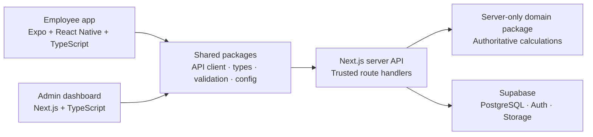

# System architecture

## Accepted shape



The diagram shows the logical boundary. ADR-003 selects Next.js Node.js route handlers, Supabase cookie sessions for web, and bearer access tokens for mobile. Storage access remains workflow-dependent.

## Boundary rules

- Mobile and web are separate user experiences with different audiences: daily employee work on mobile; administration, configuration and reporting on web.
- Both apps consume shared contracts and validation so requests and data shapes stay aligned.
- Authoritative calculations live in `packages/domain` and are imported only by server-side entry points; client apps call the server API instead.
- Authoritative business rules and privileged operations belong on the server side. A client must not be the source of truth for inventory, costing, permissions or other business invariants.
- Supabase provides PostgreSQL, Auth and Storage. The technical identity/RBAC schema uses migrations and local Supabase configuration; business schema, workflow-specific roles and policies, and private storage buckets still depend on approved workflows.
- Keep environment-specific URLs and publishable client configuration separate from secrets. Never put service-role credentials in either app or any `NEXT_PUBLIC_*` variable.
- Use local drafts and controlled syncing only where needed. Do not claim full offline support without a separate decision.

## Repository map

```text
apps/
  mobile/       Expo employee app
  web/          Next.js admin dashboard
packages/
  api-client/   shared request/client contract boundary
  domain/       server-only authoritative calculations
  types/        shared TypeScript types
  validation/   shared request and input schemas
  config/       shared TypeScript configuration
supabase/
  migrations/   PostgreSQL, Auth/RPC and RLS migrations for identity and administration; workflow tables only when approved
```

## Selected server access pattern

Next.js server route handlers provide the application API, with the Node.js runtime deployed alongside the admin application. Web clients use Supabase cookie sessions; the employee application will use bearer access tokens. Authentication goes directly to Supabase Auth, while trusted application and domain operations go through the API. Storage remains private and user-scoped when an approved workflow requires it. See [ADR-003](decisions/ADR-003-next-js-api-and-supabase-access.md).

The current technical foundation includes identity/RBAC, administration invitations, user/role management, and audit history. Detailed workflow tables, business role assignments, business invariants, and workflow-specific policies still require the approved workflow specification. The owner-provided hosted Supabase project is used for development; no production hosting has been provisioned by this repository setup.
